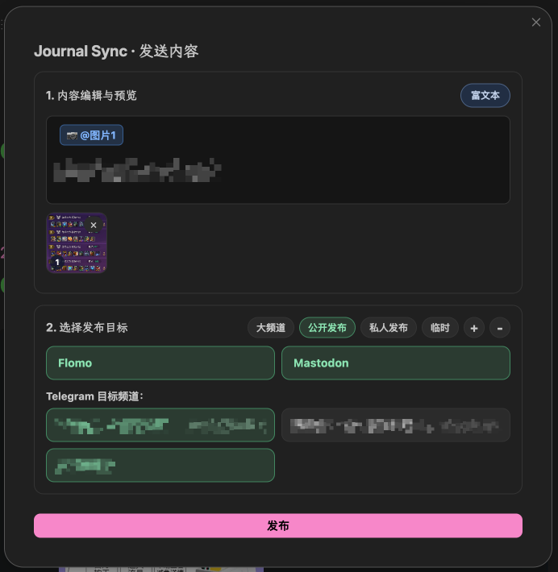
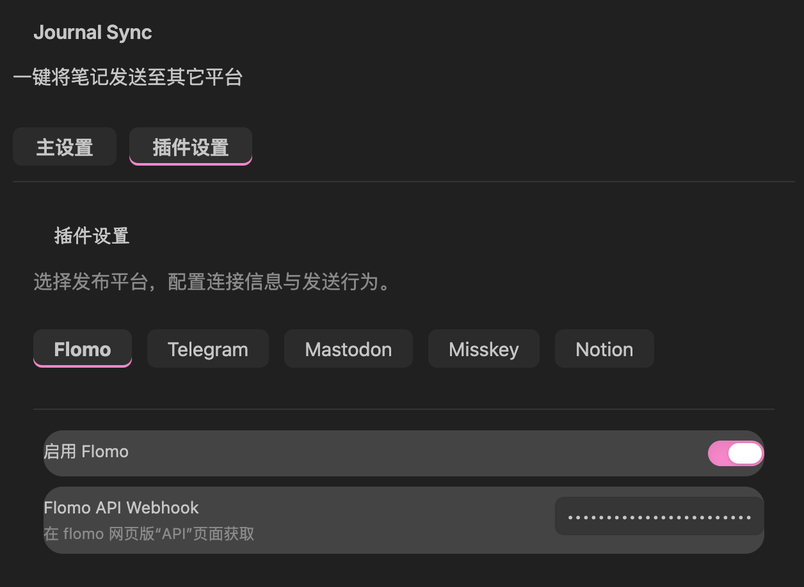

# Journal Sync

[简体中文](README.zh-CN.md) · [Installation](#installation) · [Setup](#first-time-setup) · [Development](docs/development.md)

**Write in Obsidian. Publish wherever your notes live.**

Journal Sync sends selected text, the current heading section, or an entire note from Obsidian to **flomo, Telegram, Mastodon, Misskey, Bluesky, Weibo, Notion, and Threads**. Everything runs inside Obsidian—no Node.js, Python, or separate backend service required.



## From note to published post

1. Run **JournalSync-New** to open today's journal and add a timestamped heading.
2. Write naturally, including images stored in your vault.
3. Select a passage—or leave the cursor in the section you want—and run **JournalSync-Send**.
4. Review the content, choose one or more destinations, and publish—or press <kbd>Ctrl/Cmd+Enter</kbd> to send directly.

All three commands run from the command palette: press <kbd>Ctrl/Cmd+P</kbd>, type part of the name—typing `send` finds **JournalSync-Send**—and press <kbd>Enter</kbd>. Recently used commands stay near the top, so day-to-day publishing is three steps: open the palette, run Send, click Publish. Every send is snapshotted, so **JournalSync-Log** can reopen any of the last 10 sends for editing and resending.

The publishing dialog remembers target presets, supports multiple Telegram channels, and sends in the background so you can keep working.

## What it does

- **Fast daily capture** — create or open today's journal and start at a new timestamped heading.
- **Precise publishing scope** — send a selection, the nearest configured heading section, or the complete note.
- **One publishing pass** — choose several enabled platforms and Telegram channels from one dialog, with saved target presets for one-click switching.
- **Vault-aware images** — resolve local Markdown and wiki-link images without relying on operating-system paths, or paste from the clipboard without touching your vault.
- **Editable preview** — adjust text and image order before anything is sent.
- **Send history** — the last 10 sends are snapshotted locally and can be reopened, edited, and resent.
- **Local configuration** — credentials stay in Obsidian's plugin data; Journal Sync has no intermediary server.

## Installation

1. Open the [latest GitHub Release](https://github.com/LinYunerr/Journal-Sync/releases/latest).
2. Download `main.js`, `manifest.json`, and `styles.css`.
3. Put the three files in:

   ```text
   <Vault>/.obsidian/plugins/journal-sync-bridge/
   ```

4. In Obsidian, open **Settings → Community plugins**, refresh the plugin list, and enable **Journal Sync**.

Only those three release files are needed. Do not copy `data.json`; it contains your local account configuration.

## First-time setup

Open **Settings → Journal Sync** after enabling the plugin.



1. Under **Main settings**, choose the journal folder, filename pattern, timestamp heading, default send scope, and local-image behavior.
2. Under **Plugin settings**, enable each destination you use and enter its connection details.
3. For Telegram, enter the Bot Token, fetch the available channels, and select the defaults.
4. Most platforms offer a **Test connection** button to verify credentials before publishing. On flomo it sends a real memo; the others only validate the stored token.

## Using Journal Sync

All three commands run from the Obsidian command palette (<kbd>Ctrl/Cmd+P</kbd>); you can also bind them to hotkeys under **Settings → Hotkeys**.

| Command | What happens |
| --- | --- |
| `JournalSync-New` | Creates or opens today's journal, appends a timestamped heading, and places the cursor below it. Also available from the pencil ribbon icon. |
| `JournalSync-Send` | Opens the publishing dialog for the selected text or the configured scope around the cursor. |
| `JournalSync-Log` | Opens the send log: the last 10 send snapshots, each with a **Re-edit** button that reopens the publishing dialog prefilled with that send (content, image tokens, and Telegram one-shot options restored). |

A text selection always takes priority. With no selection, Journal Sync uses the send scope configured in settings: a heading level from `#` through `######`, or the complete page. A heading section is the content below the nearest heading of that level, up to the next heading of the same or higher level; the heading line itself is not sent—when the destination is Notion, that heading's text becomes the page title instead. If the cursor is not below a heading of the configured level, or that section is empty, nothing is sent and a notice explains why. The default scope is `##`, matching the default timestamp heading level.

### Images in the publishing dialog

Local image references appear as tokens such as `@图片1`, with thumbnails below the editor. The token marks the image's position for Telegram rich publishing. Move the token to reorder the image, or remove it to exclude that image from the send. You can also paste an image from the clipboard directly into the editor—it becomes a token the same way and is sent without being written to your vault.

## Supported destinations

| Destination | Text | Vault images | Notes |
| --- | :---: | :---: | --- |
| flomo | ✓ | — | Publishes through your flomo API webhook. Testing the connection sends a real memo to flomo. |
| Telegram | ✓ | ✓ | Supports multiple channels and three send modes: standard (text with images, up to 9 per message), rich publishing that preserves image position and supported Markdown, and Telegraph—long posts are published as a Telegraph page and the link is posted to your channels. |
| Mastodon | ✓ | ✓ | Custom instance, multiple accounts, and visibility. Up to 4 images per post. |
| Misskey | ✓ | ✓ | Custom instance and visibility (public / home / followers). Up to 16 images per post. Direct-message visibility is not supported. |
| Bluesky | ✓ | ✓ | Signs in with an App Password created in Bluesky → Privacy & security → App passwords. Text is limited to 300 graphemes and 3,000 UTF-8 bytes per post, with up to 4 images (JPEG/PNG/WebP/GIF, 2 MB each). |
| Weibo | ✓ | ✓ | Publishes through the Weibo Open Platform after OAuth authorization with your own app (App Key/Secret). Plain text beyond 140 Weibo units can be sent as long text; image posts attach a single JPEG/PNG/GIF image with text capped at 140. Visibility is public or self-only. |
| Notion | ✓ | ✓ | Creates pages or database records and uploads referenced local images. Images over 5 MB can be compressed to WebP in memory before upload (optional, off by default; vault files are never modified). |
| Threads | ✓ | — | Publishes plain text (500 UTF-8 bytes per post) through the Threads Graph API after OAuth with your own Meta app. Reply permission is configurable. Images are not supported yet. |

Platform limits still apply. When a post exceeds a platform's image count, Journal Sync warns first and then sends the first images up to the limit. Long Telegram messages are split automatically; media count and caption limits follow the Telegram Bot API. A send to several platforms proceeds independently per platform—if one fails, the others are still published.

## Privacy and credentials

Journal Sync calls each destination directly from Obsidian. Tokens, webhooks, channel IDs, and other settings are stored in:

```text
<Vault>/.obsidian/plugins/journal-sync-bridge/data.json
```

`data.json` is excluded from this repository and from GitHub Releases. Never attach it to an issue or commit it. If a credential is exposed, revoke it at the corresponding platform and create a new one.

The send log also lives in the plugin directory, under `send-log/`: each of the last 10 sends is stored as a local snapshot with copies of the referenced images, so **Re-edit** can fully restore it. Delete that folder to erase the history.

## Compatibility

- Obsidian `1.5.0` or later
- Windows, macOS, and Linux
- Not marked desktop-only; verify the integrations you use on your mobile devices

## Development

Architecture, local builds, release mechanics, and adapter contribution guidance live in [docs/development.md](docs/development.md).

Journal Sync is available under the [MIT License](LICENSE).
